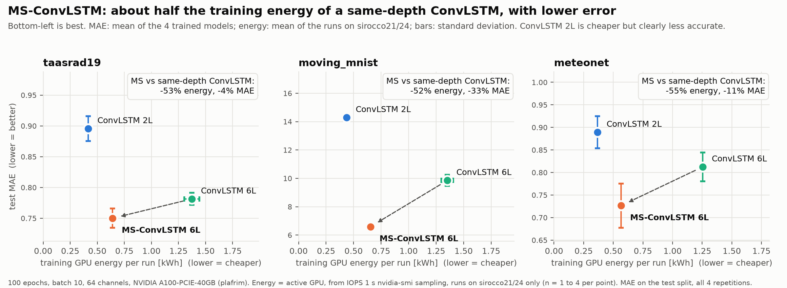

# ConvLSTM vs MS-ConvLSTM on A100 (plafrim, November 2026)

Comparison of three models on taasrad19, moving_mnist and meteonet, 4 repetitions each, run with
[IOPS](https://iops-benchmark.com) on plafrim NVIDIA A100-PCIE-40GB nodes (100 epochs, batch 10, 64 channels).

| Label | Model |
|---|---|
| `convlstm` | ConvLSTM, 2 layers (`--hidden_dims 64 64`) |
| `convlstm6l` | ConvLSTM, 6 layers (`--hidden_dims 64 64 64 64 64 64`), same depth as MS-ConvLSTM |
| `ms_convlstm` | MS-ConvLSTM, 6 layers at full/half/quarter resolution |

At the same depth, MS-ConvLSTM uses about half the training time and GPU energy of ConvLSTM and has a lower
MAE on all three datasets. The 2-layer ConvLSTM is cheaper but less accurate.

## Contents

- `iops_configs/` IOPS files used (`*_convlstm6.yaml` for the 6-layer ConvLSTM).
- `iops_runs/<stage>/run_001/` IOPS `results.csv` and `__iops_resource_summary.csv` (GPU energy, power, utilization).
- `experiments_results/` metric CSVs written by `trainer.py` and `predictor.py` (per-step loss not included).
- `analysis.py` rebuilds `tables/` and `figures/` from the two folders above (pandas, matplotlib).
- `tables/model_ratios.csv` ratios between models; `ratio_host_matched` compares only runs on the same node.

## Notes

- GPU energy is the GPU used by the job. sirocco21/24 have two A100s and the idle one is excluded.
- sirocco23 ran its GPU at lower utilization and power than sirocco21/24, so compare time and energy per node
  (marker shape in the figures, `ratio_host_matched` in the tables).
- `data_manipulation.py` now registers meteonet next to taasrad19 and moving_mnist, as used for these runs.
